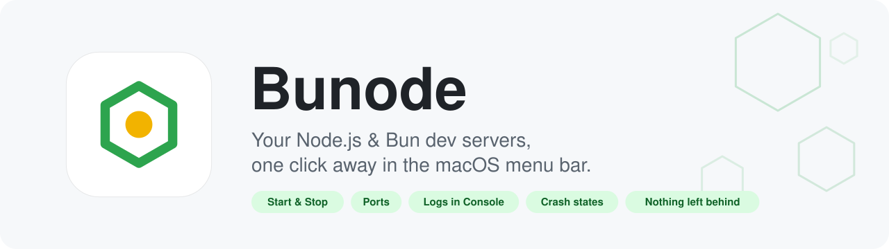
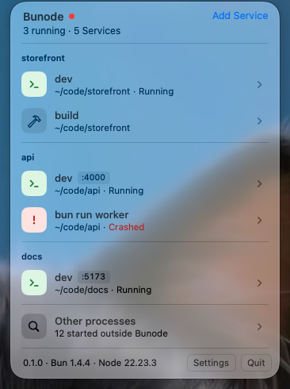
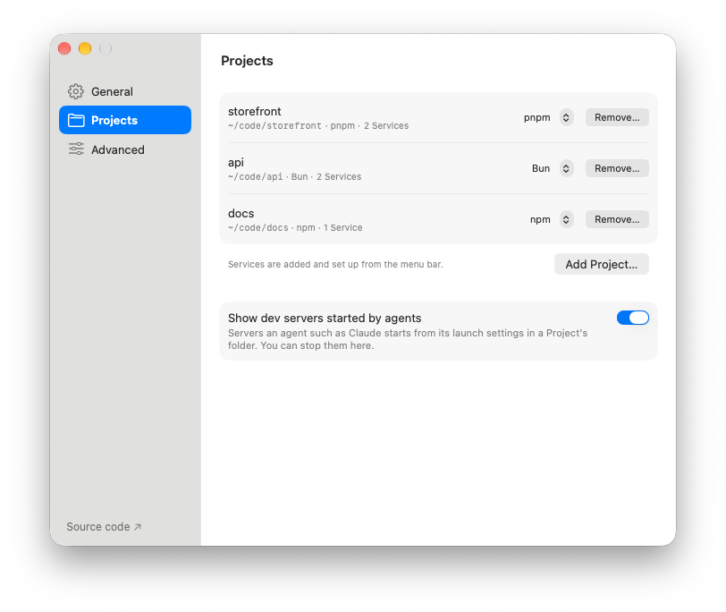
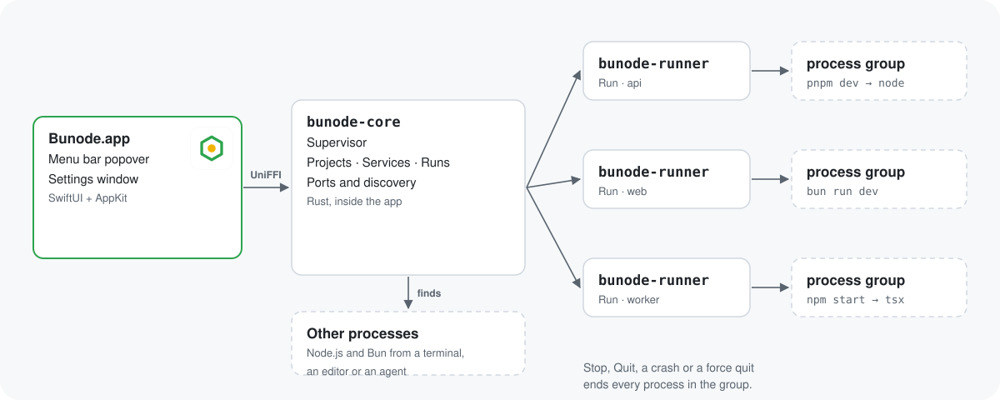

<p align="center">
  <picture>
    <source media="(prefers-color-scheme: dark)" srcset="docs/images/hero-dark.svg">
    
  </picture>
</p>

<p align="center">
  <a href="https://github.com/imal1/bunode/releases/latest"><b>Download</b></a> ·
  <a href="#quick-start">Quick start</a> ·
  <a href="#faq">FAQ</a> ·
  <a href="CHANGELOG.md">Changelog</a> ·
  <a href="README.zh-CN.md">简体中文</a>
</p>

<p align="center">
  <a href="https://github.com/imal1/bunode/actions/workflows/ci.yml"></a>
  
  
  
  
  <a href="LICENSE"></a>
</p>

---

You have a few projects open, each with a `dev` script or two. One terminal tab per server, a port you can't remember, a server that died an hour ago without anyone noticing, and a `node` process still holding port 3000 after you closed the tab.

**Bunode puts all of them in one menu bar list.** Click to start, click to stop, see which port each one is on and which one crashed. When Bunode quits, everything it started quits with it.

<p align="center">
  
  &nbsp;
  
</p>
<p align="center"><sub>The menu bar popover, and Settings › Projects.</sub></p>

## Why Bunode

- **🖱 One click, not one terminal tab per server.** Every `package.json` script of every Project you add, monorepo packages included, with Start, Stop and Restart right in the row.
- **🔌 Ports you don't have to remember.** Bunode sees the ports each Run actually listens on and links to them. Before Start it checks the port is free, and tells you who has it if it isn't.
- **💥 Crashes you actually notice.** Crashed, Failed and Not responding each get their own state, and the menu bar icon shows how many Services are running.
- **🧹 Nothing left behind.** Each Run gets its own process group behind a tiny `bunode-runner`. Stop, Quit, a crash of Bunode or even a force quit ends every process the Service started, grandchildren included.
- **📜 Logs where macOS keeps logs.** Every Run writes a log file that opens in Console, which follows it live with its own search.
- **🕵️ The servers you didn't start here.** Node.js and Bun processes started from a terminal, an editor or a coding agent show up under *Other processes*, with where they came from and a careful Stop.
- **🪶 Native and light.** SwiftUI and AppKit over a Rust core. No Electron, no Dock icon, no background daemon: Bunode lives in the menu bar and is gone when you quit it.

## How it works

<p align="center">
  <picture>
    <source media="(prefers-color-scheme: dark)" srcset="docs/images/how-it-works-dark.svg">
    
  </picture>
</p>

A **Project** is a folder you register. A **Service** is something in it you run, usually a `package.json` script. A **Run** is one start of a Service, from Start to exit. The Supervisor in `bunode-core` runs inside the app; the per-Run `bunode-runner` is what makes sure no Run outlives Bunode. [`GLOSSARY.md`](GLOSSARY.md) has the full vocabulary and [`docs/adr/`](docs/adr/) the reasoning.

## Features

| | |
|---|---|
| **Projects** | Add a folder in Settings and give it a short alias. npm, pnpm, Yarn and Bun are detected from the lockfile, with a picker when there are several. |
| **Services** | Pick from the `package.json` scripts (common ones like `dev` and `start` first) or type any command. Monorepo packages from `workspaces` and `pnpm-workspace.yaml` are listed too. |
| **Runs** | Start, Stop, Restart. Short-lived scripts such as `build` are told apart from long-running servers. Stop sends SIGTERM first and force-quits after a timeout you set. |
| **Environment** | Services run with your login shell's environment, so `nvm`, `fnm`, `volta` and your `PATH` work as they do in Terminal. |
| **Ports** | Detected per Run, with Open in Browser. A busy port is caught before Start. |
| **Logs** | stdout and stderr in one file per Run, opened in Console. |
| **Other processes** | Node.js and Bun processes started elsewhere, and the dev servers that Claude starts from a Project's `.claude/launch.json`. |
| **List** | Flat, or grouped by Project. Running count next to the menu bar icon. |
| **Keyboard** | Arrow keys, Return, Space and Esc in the popover, VoiceOver labels, ⌘, for Settings. |
| **Languages** | English and 简体中文, switched in Settings › General. |

## Quick start

1. **Install.** Download `Bunode-x.y.z.zip` from the [latest release](https://github.com/imal1/bunode/releases/latest), unzip it and move **Bunode.app** to Applications. Or [build it from source](#build-from-source).
2. **Open it.** Look for the hexagon in the menu bar. Bunode has no Dock icon.
3. **Add a Project.** Settings (⌘,) › Projects › *Add Project…* and pick a folder.
4. **Add a Service.** Open the menu bar popover, click **Add Service** and choose a script such as `dev`.
5. **Start it.** Hover its row and click ▶. The port shows up as soon as the server listens on it.

## FAQ

<details>
<summary><b>macOS says Bunode “cannot be opened” or “is damaged”.</b></summary>

Release builds are not notarized yet. Control-click Bunode.app in Finder and choose **Open**, or run:

```bash
xattr -dr com.apple.quarantine /Applications/Bunode.app
```
</details>

<details>
<summary><b>What happens to my servers when I quit Bunode?</b></summary>

They stop. If any are running, Bunode asks first, then stops every Run and waits for it to end. On logout and shutdown it stops them without asking. Processes listed under *Other processes* are only watched, never stopped on quit.
</details>

<details>
<summary><b>Can a Service be something other than Node.js or Bun?</b></summary>

Yes. A Service can run any command and gets the same process group, logs, port detection and stop logic. Script detection, package managers and *Other processes* stay Node.js and Bun only ([ADR-0005](docs/adr/0005-any-command-node-bun-first.md)).
</details>

<details>
<summary><b>Where are the logs and settings?</b></summary>

Settings and Projects are in `~/Library/Application Support/Bunode`. Bunode's own logs are in `~/Library/Logs/Bunode`, and Settings › Advanced has a button for them. A Run's log opens from its Service view with **Open in Console**.
</details>

<details>
<summary><b>Why macOS 26 only?</b></summary>

Bunode is built on the SwiftUI and AppKit of macOS 26. Supporting older releases would mean a second set of views to build and test.
</details>

## Build from source

You need macOS 26 or later, Xcode 26 or later, Rust from [rustup](https://rustup.rs) and [XcodeGen](https://github.com/yonaskolb/XcodeGen) (`brew install xcodegen`).

```bash
git clone https://github.com/imal1/bunode.git
cd bunode
make run
```

`make run` builds the Rust core, generates the Xcode project, builds a universal `Bunode.app` and opens it. Development builds are signed ad hoc, so no Apple developer account is needed. [`CONTRIBUTING.md`](CONTRIBUTING.md) covers the other `make` targets, working in Xcode, the code layout, tests and releases.

## Documentation

| | |
|---|---|
| [`docs/requirements.md`](docs/requirements.md) | What Bunode does and doesn't do |
| [`docs/design-handoff.md`](docs/design-handoff.md) | Every screen, state and string |
| [`docs/adr/`](docs/adr/) | Architecture decisions and why |
| [`docs/stability.md`](docs/stability.md) | How stability and performance are tested |
| [`GLOSSARY.md`](GLOSSARY.md) | Project, Service, Run and the rest |
| [`CHANGELOG.md`](CHANGELOG.md) | What changed in each version |

## Contributing

Bug reports, ideas and pull requests are welcome. Open an [issue](https://github.com/imal1/bunode/issues) first for anything bigger than a fix, and see [`CONTRIBUTING.md`](CONTRIBUTING.md) for how to build and test.

## License

[MIT](LICENSE) © 2026 imal1
