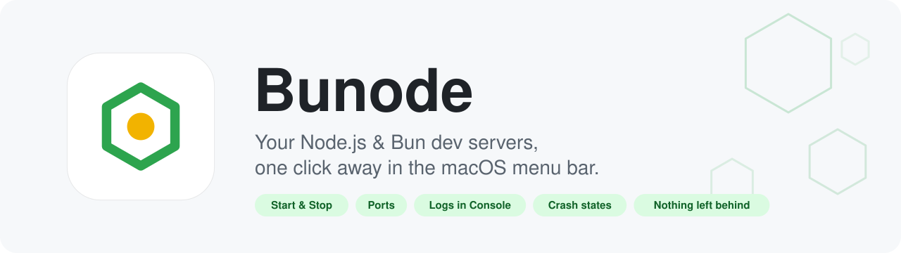
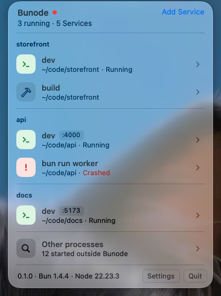
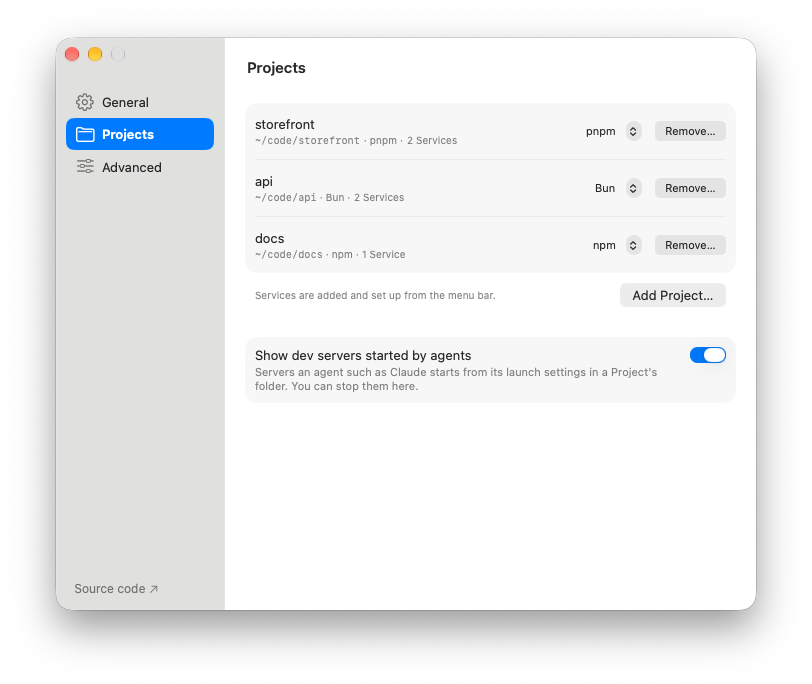
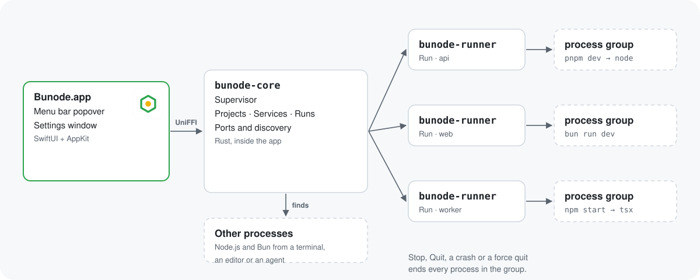

<p align="center">
  <picture>
    <source media="(prefers-color-scheme: dark)" srcset="docs/images/hero-dark.svg">
    
  </picture>
</p>

<p align="center">
  <a href="https://github.com/imal1/bunode/releases/latest"><b>下载</b></a> ·
  <a href="#快速开始">快速开始</a> ·
  <a href="#常见问题">常见问题</a> ·
  <a href="CHANGELOG.md">更新日志</a> ·
  <a href="README.md">English</a>
</p>

<p align="center">
  <a href="https://github.com/imal1/bunode/actions/workflows/ci.yml"></a>
  
  
  <a href="LICENSE"></a>
</p>

---

同时开着好几个项目，每个都有一两个 `dev` 脚本：一个服务占一个终端标签页，端口记不住，某个服务一小时前就挂了却没人发现，标签页关了 `node` 还占着 3000 端口。

**Bunode 把它们都放进菜单栏的一个列表里。** 点一下启动，点一下停止，哪个服务在哪个端口、哪个崩了，一眼就能看到。Bunode 退出时，它启动的一切都会跟着退出。

<p align="center">
  
  &nbsp;
  
</p>
<p align="center"><sub>菜单栏 Popover 与 设置 › 项目。</sub></p>

## 为什么用 Bunode

- **🖱 一键启停**：添加的每个项目里的 `package.json` 脚本（含 monorepo 子包），在列表行里直接启动、停止、重启。
- **🔌 端口不用记**：自动识别每次运行实际监听的端口并给出链接；启动前检查端口是否被占用，被占用时告诉你是谁占的。
- **💥 崩溃看得见**：已崩溃、失败、无响应各有状态，菜单栏图标旁显示运行中的服务数。
- **🧹 不留残余进程**：每次运行都有独立进程组和一个小小的 `bunode-runner`。停止、退出、Bunode 崩溃甚至强制退出，都会结束该服务启动的所有进程。
- **📜 日志交给“控制台”**：每次运行写一个日志文件，在 macOS 控制台中实时查看和搜索。
- **🕵️ 不是在这里启动的也看得到**：终端、编辑器或编码 agent 启动的 Node.js / Bun 进程会出现在“其他进程”里，标明来源，可安全停止。
- **🪶 原生、轻量**：SwiftUI + AppKit，核心用 Rust。没有 Electron，没有 Dock 图标，没有后台守护进程。

## 工作原理

<p align="center">
  <picture>
    <source media="(prefers-color-scheme: dark)" srcset="docs/images/how-it-works-dark.svg">
    
  </picture>
</p>

**项目（Project）**是你登记的一个文件夹；**服务（Service）**是其中要运行的东西，通常是一个 `package.json` 脚本；**运行（Run）**是服务从启动到退出的一次。术语见 [`GLOSSARY.md`](GLOSSARY.md)，设计取舍见 [`docs/adr/`](docs/adr/)。

## 功能

| | |
|---|---|
| **项目** | 在设置里添加文件夹并起个短别名；根据 lockfile 识别 npm、pnpm、Yarn、Bun，有多个时可手动选择。 |
| **服务** | 从 `package.json` 脚本中选择（`dev`、`start` 等常用脚本优先），或输入任意命令；也列出 `workspaces` 和 `pnpm-workspace.yaml` 中的子包。 |
| **运行** | 启动、停止、重启；区分 `build` 这类短命脚本和常驻服务；停止时先发 SIGTERM，超时后强制结束（时长可设）。 |
| **环境变量** | 使用登录 shell 的环境变量，`nvm`、`fnm`、`volta` 和 `PATH` 与终端里一致。 |
| **端口** | 按运行识别，可在浏览器中打开；启动前发现端口冲突。 |
| **日志** | stdout 和 stderr 写入每次运行的日志文件，在控制台中打开。 |
| **其他进程** | 在别处启动的 Node.js / Bun 进程，以及 Claude 根据项目 `.claude/launch.json` 启动的开发服务。 |
| **列表** | 平铺或按项目分组；菜单栏图标旁显示运行数。 |
| **键盘** | Popover 支持方向键、回车、空格、Esc 和 VoiceOver；⌘, 打开设置。 |
| **语言** | English 和简体中文，在“设置 › 通用”中切换。 |

## 快速开始

1. **安装**：从[最新 Release](https://github.com/imal1/bunode/releases/latest) 下载 `Bunode-x.y.z.zip`，解压后把 **Bunode.app** 拖进“应用程序”。也可以[从源码构建](#从源码构建)。
2. **打开**：在菜单栏找到六边形图标，Bunode 没有 Dock 图标。
3. **添加项目**：设置（⌘,）› 项目 › *添加项目…*，选择文件夹。
4. **添加服务**：打开菜单栏 Popover，点 **添加服务**，选一个脚本，比如 `dev`。
5. **启动**：鼠标移到该行，点 ▶。服务开始监听后端口会自动显示。

## 常见问题

<details>
<summary><b>macOS 提示“无法打开”或“已损坏”？</b></summary>

Release 版本暂未公证。在访达中按住 Control 点按 Bunode.app 选择**打开**，或运行：

```bash
xattr -dr com.apple.quarantine /Applications/Bunode.app
```
</details>

<details>
<summary><b>退出 Bunode 时，正在运行的服务怎么办？</b></summary>

会被停止。有服务在运行时会先确认，然后停止所有运行并等待结束；注销和关机时不询问直接停止。“其他进程”里的进程只做观察，退出时不会停止。
</details>

<details>
<summary><b>服务可以不是 Node.js 或 Bun 吗？</b></summary>

可以。服务可以运行任意命令，同样享有进程组、日志、端口识别和停止逻辑；脚本识别、包管理器和“其他进程”仍只针对 Node.js 和 Bun（[ADR-0005](docs/adr/0005-any-command-node-bun-first.md)）。
</details>

<details>
<summary><b>日志和设置存在哪里？</b></summary>

设置和项目在 `~/Library/Application Support/Bunode`，Bunode 自身日志在 `~/Library/Logs/Bunode`（设置 › 高级 中有入口）。单次运行的日志在服务页点**在控制台中打开**。
</details>

## 从源码构建

需要 macOS 26+、Xcode 26+、[rustup](https://rustup.rs) 安装的 Rust，以及 [XcodeGen](https://github.com/yonaskolb/XcodeGen)（`brew install xcodegen`）。

```bash
git clone https://github.com/imal1/bunode.git
cd bunode
make run
```

其他 `make` 目标、Xcode 开发、代码结构、测试与发版流程见 [`CONTRIBUTING.md`](CONTRIBUTING.md)。

## 许可证

[MIT](LICENSE) © 2026 imal1
